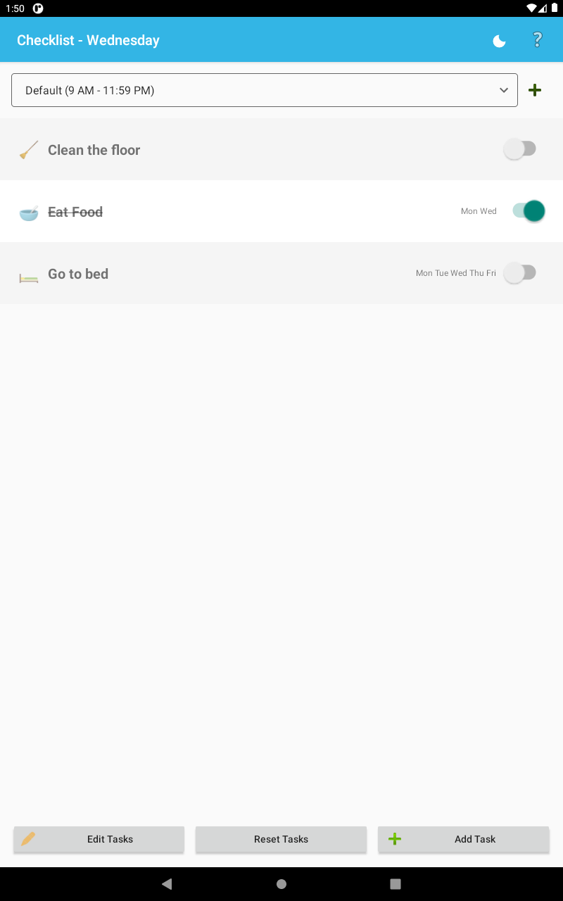
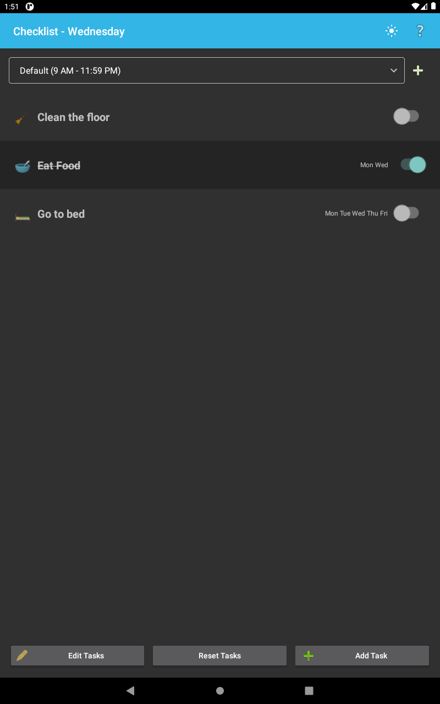
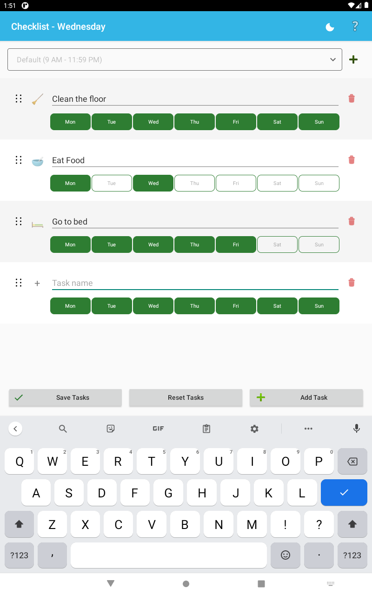
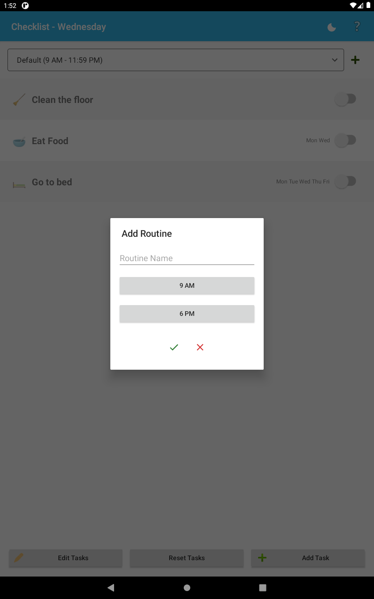

# Checklist Android App

A native Android checklist for organizing tasks into routines.

## Features

- Create, edit, and delete routines, each with a name and start/end times.
- Add tasks to the selected routine, then edit names, assign emojis, delete, and reorder tasks in a shared editing mode.
- Schedule tasks for specific weekdays; the checklist shows tasks scheduled for the current day.
- Mark tasks complete and reset completion status.
- Switch between light and dark mode; the selection is saved between launches.
- Store routines and tasks locally on the device.
- Export and restore tasks and routines as a JSON backup from the About menu.

The task list shows the selected routine's tasks for the current weekday in their configured order. Routine times are displayed but do not automatically filter tasks by the current time.

## Screenshots

| Light mode | Dark mode |
|---|---|
|  |  |

| Add a task | Add a routine |
|---|---|
|  |  |

## Task Workflow

- Select a routine from the list at the top of the screen.
- Choose **Edit Tasks** to change task names, assign weekdays, assign or clear emojis from categorized groups, delete tasks, and drag tasks into order.
- Choose **Add Task** to insert a blank task inline. Choose **Save Tasks** to save task edits and ordering.

## Requirements

- Android 11 (API 30) or higher for a device or emulator.
- Android SDK Platform 37.
- JDK 21 for the Gradle build. The Gradle wrapper is configured to provision its JDK toolchain.

## Build and Install

From the project root in Windows PowerShell, build the debug APK:

```powershell
.\gradlew.bat :app:assembleDebug
```

The APK is written to `app/build/outputs/apk/debug/app-debug.apk`.

With a device or emulator connected, install the debug build with:

```powershell
.\gradlew.bat :app:installDebug
```

To build, install, and launch on a running emulator using the npm script (requires Node.js/npm and Android `adb` on `PATH`):

```powershell
npm run deploy:emulator
```

This script removes `app/build` before building and installing the app.

You can also open the project in Android Studio, sync Gradle, and run the `app` configuration on a device or emulator.

## Data

Create and manage routines and tasks in the app. They are saved locally using Android SharedPreferences. Use **About > Backup and restore** to export a JSON backup to local storage or restore one later.